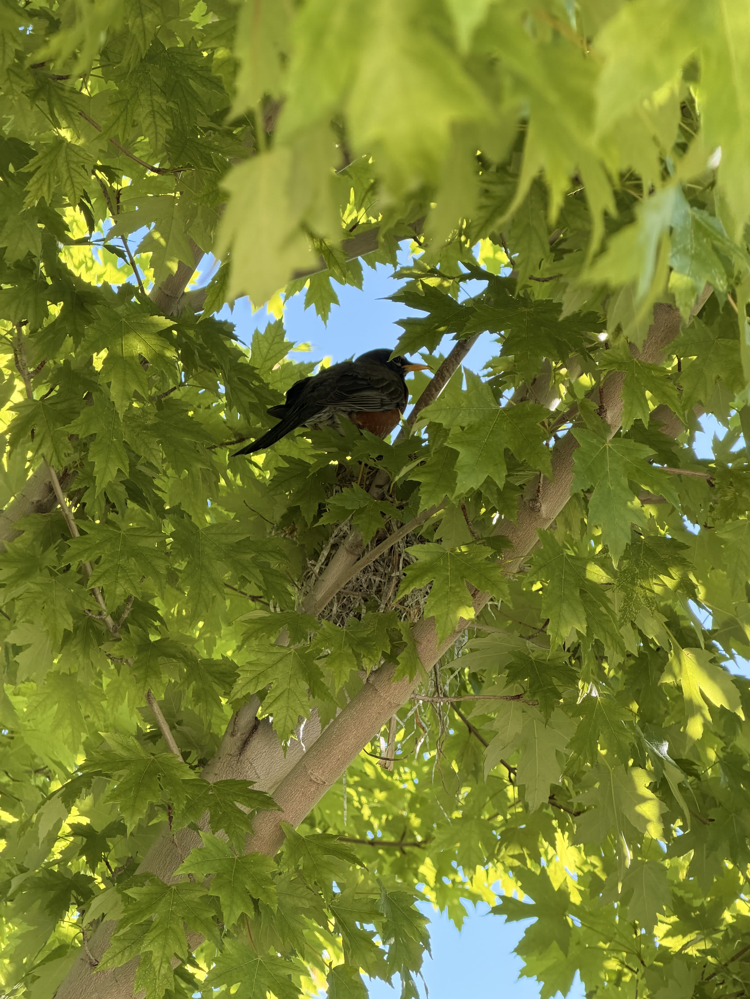
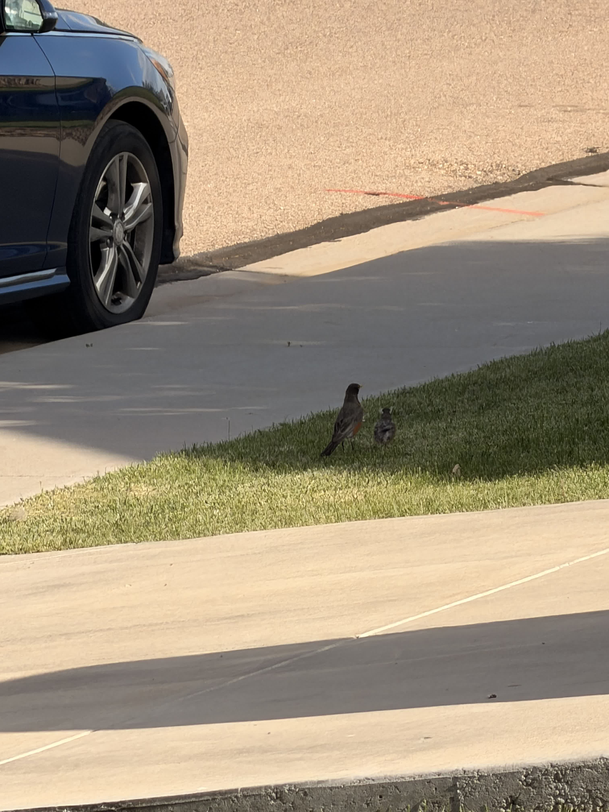

Today is day 24 of the Codevember challenge. Codevember is a coding challenge where people build small projects based on a word or theme for each day in November. I am following [@thespite](https://x.com/thespite) (Jaume Sanchez Elias) on X. He generated an unofficial prompt list for every day. [Jaume's post](https://x.com/thespite/status/2116974998212772095?a=Ja7aa-sznyd9T6J_JNo&s=46) Today's day 24 prompt is:

nest

This is the prompt I started with and gave to ChatGPT Work mode on my iPhone:



Theme for the day:

nest

Create a polished interactive 3D web experience for Codevember 2026, Day 24.

Project folder: Codevember-2026/24/

Title: First Peck

On-screen instruction: Tap the cracked egg to watch it hatch.

### Scene

Begin with a close-up of an American robin's nest tucked into the fork of a tree in spring. Build the nest from layered twigs, dry grasses, and fine fibers, with a soft lining inside the cup. Frame it with fresh green leaves, a few buds, and dappled morning light. Let the background suggest a larger tree canopy while keeping the nest as the focus.

Place exactly three robin-blue eggs in the nest. Two eggs stay intact. The third sits near the front where visitors can see a small crack in its shell. Frame the opening view from slightly above so all three eggs and the nearby adult robin are visible.

Perch an adult American robin on a nearby branch, close enough to see its orange breast and gray-brown back. The adult is on the lookout. Give it occasional blinks, small head turns, and a moment when it glances toward the nest after hearing the chick peck.

### Hatching interaction

Before the visitor interacts, give the cracked egg an occasional tiny wobble. When the visitor taps or clicks it, animate a short hatching sequence:

1. The egg rocks gently, then pauses.

2. The chick pecks from inside, and the crack widens with each peck.

3. A small piece of shell tips outward and settles in the nest.

4. The chick's head becomes visible. Show its closed or barely open eyes, sparse down, and small beak as it makes one more peck.

End with the baby robin still partly inside the egg and its head visible. Keep all three eggs in the nest throughout the sequence. Let visitors replay the moment with a small Replay button that appears after the animation finishes.

### 3D camera and controls

Use Three.js and WebGL to build the nest, eggs, chick, adult robin, branches, and leaves as real 3D geometry. Give the nest and main branches enough detail to hold up from every angle.

Start with a slow, subtle camera orbit centered on the nest. Let visitors drag with a mouse or one finger to orbit a full 360 degrees horizontally and tilt up or down. Support pinch and scroll-wheel zoom. Stop the automatic orbit as soon as the visitor moves the camera. Set sensible tilt and zoom limits so the camera stays outside the eggs and branches. Keep the camera usable while the egg hatches, and distinguish a tap from an orbit gesture so dragging across the egg does not trigger it.

### Responsive and accessible design

Let the scene fill the screen. Keep the title, one short instruction, and compact controls at the edges so they leave the nest visible. Frame the opening view separately for portrait and landscape screens so both the adult robin and the nest are easy to find.

Give keyboard and screen-reader users an accessible Hatch egg button that triggers the same sequence as tapping the egg. Support arrow keys for orbiting, plus and minus for zoom, and a Reset view control. Provide visible focus, comfortably sized touch targets, and a brief screen-reader announcement when the chick's head emerges.

Include a Pause motion control. Honor prefers-reduced-motion by starting with a still camera, reducing ambient motion, and showing the hatching in a few gentle stages when activated. Make the pecks and shell movement clear visually so the interaction works without sound. If WebGL is unavailable, show a short text description of the scene and the hatching moment.

### Deliverable

Build the complete project inside Codevember-2026/24/ using HTML, CSS, JavaScript, and Three.js. Use relative paths so it works on GitHub Pages under /codevember-2026/24/. Verify the hatching, replay, and camera controls with mouse, touch, and keyboard, and check the opening composition on a narrow phone screen.



I used GPT Sol 6.2 - High again. It is giving pretty acceptable results for working with three.js. I think it's also cheaper than using my Copilot AI credits with VS Code. Three.js was used. The page is interactive, responsive, and accessible. I gave ChatGPT the above prompt and it churned for about fifteen minutes minutes or so. I did eight iterations. Visually it looks great. Realistically you can get the picture of "nest". I have been using ChatGPT to help me with my prompts and it seems to be working pretty good. Anyway, another fun day. Keep exploring!

My sister Marsha and I watched a real robin's nest last spring. The robins built a nest right outside my window in our maple tree. Three eggs hatched around the beginning of June. Marsha named at least two of the chicks: Patrick, and Penelopy. Here are a couple of pictures:


  
  


  Check out the build here: [Codevember Day 24 ~ nest](https://gregpuzzles1.github.io/codevember-2026/24/)
